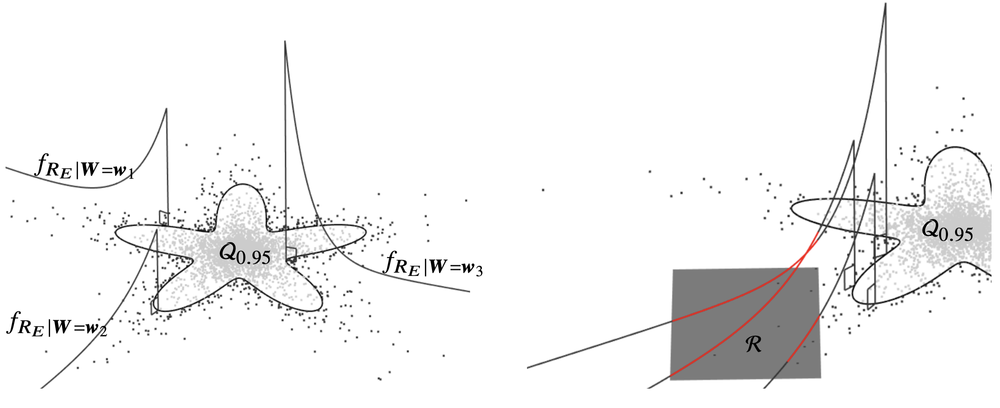
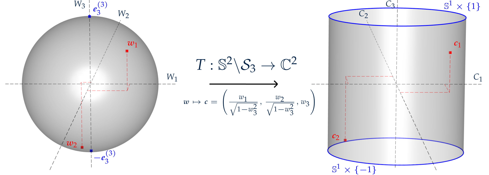
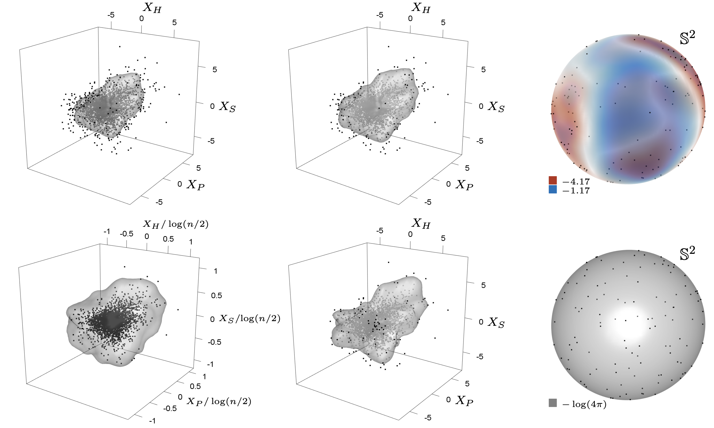
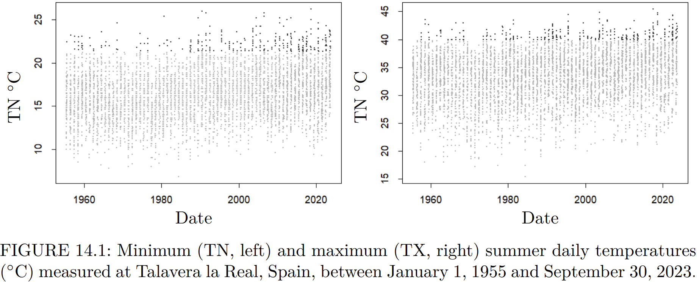
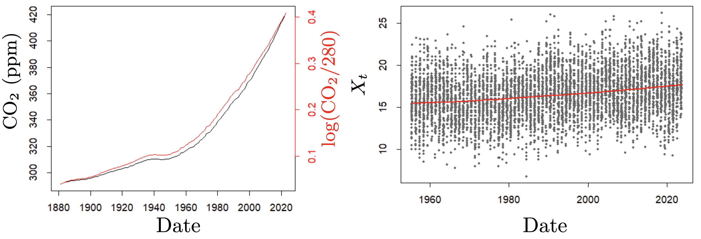

## [geometricExtremesNF](https://github.com/lambertdem/geometricExtremesNF) Python code {#geometricextremesnf}

A generative modelling approach for multivariate extremes based on:

De Monte, L., Huser, R., Papastathopoulos, I., and Richards, J. (2025) 'Generative modelling of multivariate geometric extremes using normalising flows', [arXiv](https://arxiv.org/abs/2505.02957) preprint.

 

 

## [geometricExtremes](https://github.com/ipapasta/geometricExtremes) R package {#geometricextremes}

A Bayesian approach to extreme value analysis based on:

Papastathopoulos, I., De Monte, L., Campbell, R. and Rue, H. (2023) 'Statistical inference for radial generalized Pareto distributions and return sets in geometric extremes', [arXiv](https://arxiv.org/abs/2310.06130) preprint.

 

 

## [TSExtremes](https://github.com/lambertdem/Ch14_TSExtremes) R code {#tsextremes}

A conditional extremes approach to model the extremes of stationary time series:

G. Auld, L. De Monte, and I. Papastathopoulos. Time series in extremes. In M. de Carvalho, R. Huser,
P. Naveau, and B. J. Reich, editors, Handbook on Statistics of Extremes. Chapman & Hall, 2026. 

<!-- 
 
 -->

 
